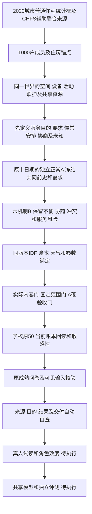

# 完整生产链与当前验收

2026-10-13新增生成前置G0：[EB六类要求](EB_SIX_TYPE_REQUIREMENT.md)。六类配额已确定，角色适用域、政策到作息/服务的实现与原50户恢复验收尚未完成；旧版验收不满足新要求，新版生成与EP保持关闭。下文V23结果保留为历史范围。

现行验收为V23，设计世界与A/B为冻结V22。源码根为 `docs/research/collection-adjustment-20260930/household1000/`，当前子目录 `gate_repair_production_20261013_v23`。历史阶段只作为有hash的前置来源，不替代当前验收。

| 环节 | 当前依据与实现 | 可支持的结论 |
|---|---|---|
| 人口与同户联合 | 七普同分母城市普通住宅控制；CHFS同住代理；V6统计框与V23 `joint_age.py` | 来源支持粗粒度关系/年龄/工作相关；未识别联合由明确模型补全，不能称1000真实户 |
| 住房与空间 | H6建筑面积/H7自然间口径、原DeST几何材料、联合住房/床位/共享权利 | 同户成员、自然间、功能空间与设备可接入；不是实际户型或实测热校准 |
| 设备 | 固定原EB六功能模型、V23 `worlds.py` 与 `compile_inputs.py` | 4–6类覆盖与实际资产一致，洗烘共机；覆盖不是拥有率 |
| 完整作息 | `activity_model.py`、官方节假日、明确迁移校历、睡眠规范与来源身份 | 以年龄、工作/学习、照护和日期协调参考日程；精确钟点是给定条件 |
| 服务目的与A | `needs.py`、`plans.py`、`execution.py`、`vehicle_state.py` | 服务目的先于计划；共享资源、装取/插拔与交付分开；A先冻结，额外帮助显式给定 |
| B及差异 | `generate.py`、`checks.py`、机制/车辆反例 | 六机制有适用条件，近边界/不便/联动/协商与坏B保留；不自动推导真人评价 |
| IDF接口 | `compile_inputs.py`、IDF/物理输入/模型审核 | 20000静态输入及原50诊断IDF绑定；输出与时轴来自相同账本 |
| 验收三门 | `ep_gate.py`、`acceptance_controls.py`、`physics.py` | 实际文件内容签名、冻结原50期望集合、A服务及10分钟平均功率拒收；全量1000拒绝 |
| 物理与敏感性 | `reuse_physical_results.py`、`physics.py`、`model_form_diagnostic.py`、`weather_audit.py` | 原50的500基线/200前史入水/50模型形式对；1400唯一物理输出精确复用并按当前账本验收 |
| 原问卷与导出 | `materials.py`、500案例绑定/时轴检查、当前浏览器测试、无案例 `frontend_snapshot/` | 1000角色及10000任务；原50显示条件后果，9500任务物理待验；当前回答与模型输入隔离 |
| 最终闭合 | `scientific_review.py`、`source_diagnostics.py`、`final_acceptance.py` | 来源—主张—未知、共享模型目的、实际文件与SQL、当前材料及DELIVERY自查；限定参考验收 |
| 真人与评测 | `HUMAN_PILOT_PROTOCOL.md`及目的合同 | 当前0答案；理解、角色作用、独立标签与总反馈预算B/合法历史k的分组评测尚待执行 |

08:00至次日08:00是完整24小时，跨夜端点保留。7/14日前史用于状态敏感性，后续服务尾段有限；没有全年运行或等末态净节能结论。原空调范围外截断、严格湿球点失败和B未交付服务继续显示，不能筛掉不利结果。

每项完整来源/假设/参数含义/可证主张见 [科研链条](../research/collection-adjustment-20260930/household1000/gate_repair_production_20261013_v23/PRODUCTION_LOGIC_CHAIN.md) 和 [依据审查](../research/collection-adjustment-20260930/household1000/gate_repair_production_20261013_v23/EVIDENCE_CHAIN_REVIEW.json)。当前自查并非独立同行评审；日期随机也不使B机制成为真实行为因果实验。

实际可复核路径在 [PIPELINE.json](PIPELINE.json)；合法前置输入见 [INPUTS.md](INPUTS.md)。公开源码能够审阅全链，受控原始数据不随源码再分发。全过程验收报告明确区分当前回读、精确旧SQL复用、工程填写与尚缺人类证据。
